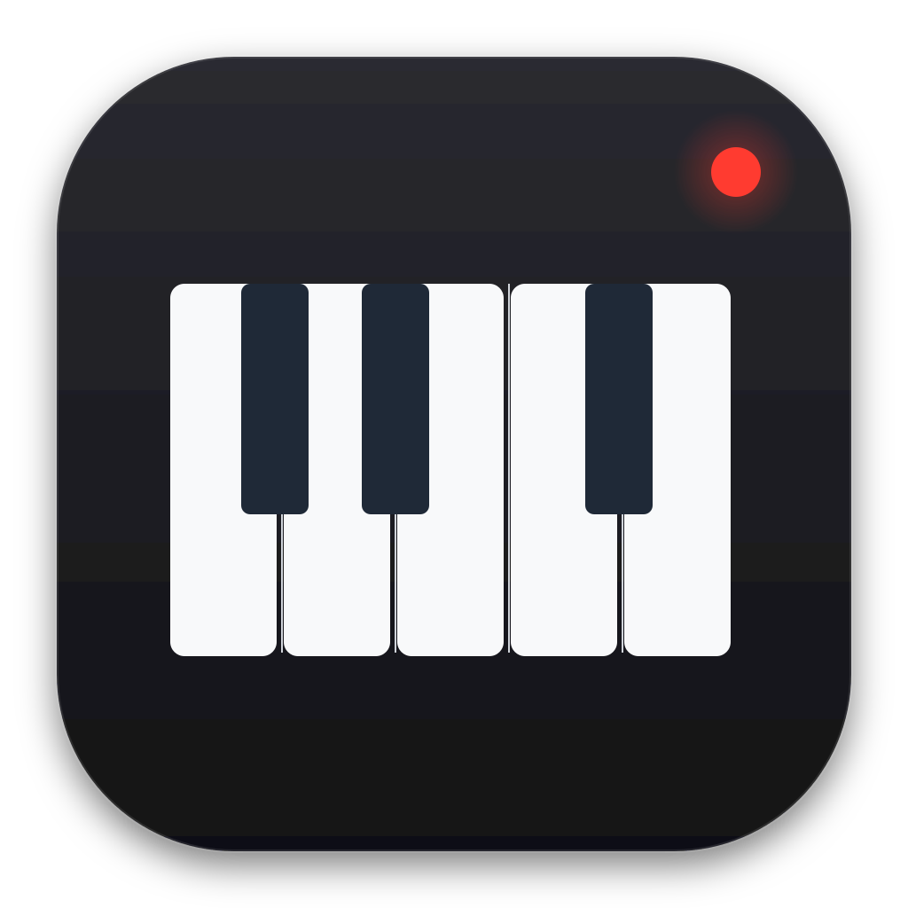

# MIDIRecorder



macOS menu bar app that automatically captures live MIDI into `.mid` files.

## How it works

Inspired by Pianoteq's recording workflow, MIDIRecorder listens to all connected MIDI sources and records channel events (notes, controllers, program changes, etc.) into a `MusicSequence`. After **5 seconds of silence**, the current sequence is saved as a standard MIDI file and a new recording session begins automatically. Clock, active sensing and SysEx messages are ignored, so devices that send them constantly do not prevent saving. Takes without any notes are discarded. A take is cut after 30 minutes, so a long continuous performance becomes several files.

## Build & run

```bash
./build.sh          # builds MIDIRecorder.app
./test.sh           # parser tests
open MIDIRecorder.app  # launch
```

The app runs as a menu bar item (no Dock icon) with a piano keys icon. Click the icon to open the control popover.

## Features

- **Automatic recording**: captures all incoming MIDI from every connected source
- **Auto-save on silence**: saves after 5 seconds of no input, then starts a new file
- **Pause/resume**: button in the popover; while paused nothing new is recorded (except note-offs for notes already held)
- **Save on quit**: quitting saves the take in progress
- **Live metrics**: shows note count and last saved filename in the popover; save or MIDI setup errors appear there too
- **Post-save shell command**: run any command after each save (use `%f` for full path, `%n` for filename). It runs in the background via `/bin/sh -c`; quote the placeholders, since filenames contain spaces. It will probably not run for the take saved on quit. It gets macOS's short `PATH` (`/usr/bin:/bin:/usr/sbin:/sbin`), so use full paths for Homebrew tools.
- **Launch at Login**: toggle from the popover without editing config files

## Output

MIDI files are saved to `~/Documents/MIDIRecorder/` with names following the format:

```
yyyy-MM-dd HHmm (EEEE) N notes, S seconds.mid
```

Two takes starting in the same minute with the same note count and length get the same name; the later one overwrites the earlier.

`S` counts from the first event to the save, so it includes the 5 seconds of silence.

Example: `2026-10-10 1430 (Saturday) 47 notes, 12 seconds.mid`

The first launch asks for access to the Documents folder. After a rebuild macOS may ask again; sign with a real certificate to avoid it: `SIGN_IDENTITY="<cert name>" ./build.sh`.

## Requirements

- macOS 13+
- Swift 6.1+ (compiled via `swiftc`; see `.swift-version`)
